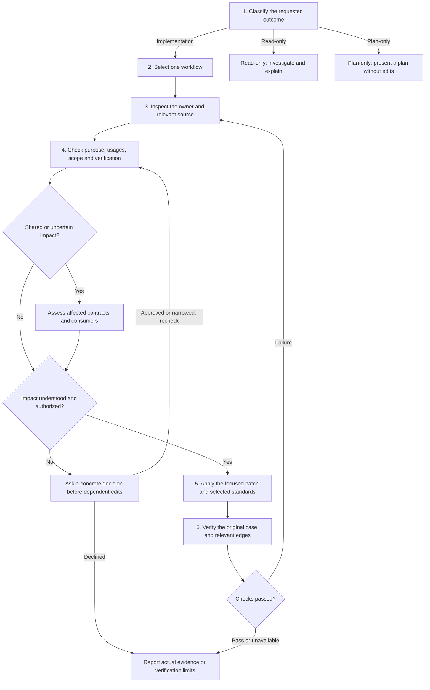

# Agent Decision Flow

Optional developer overview. Read the selected rules directly during a task; the diagram does not execute or enforce a classifier. Select any step to open its canonical instructions.

| Step                    | Detailed behavior                                                                                          |
| ----------------------- | ---------------------------------------------------------------------------------------------------------- |
| Classify and select     | [Prompt selector](../../README.md#1-classify-the-prompt)                                                   |
| Inspect source          | [Bounded context](context.md)                                                                              |
| Check every edit        | [Common local check](../standards/common.md#before-an-edit)                                                |
| Expand only when needed | [Impact](impact.md), [shared consumers](shared-code.md), [scope](change-scope.md), [approval](approval.md) |
| Implement               | [Selected topics](implementation-rules.md) in the chosen workflow                                          |
| Verify and report       | [Acceptance and evidence](verify.md)                                                                       |

When new evidence changes responsibility, [switch rules](switch-rules.md) without treating rule loading as broader permission. Approval does not prove compatibility; unavailable checks remain explicit limits. Failed verification returns to investigation. Plan-only work waits for explicit implementation authorization.
