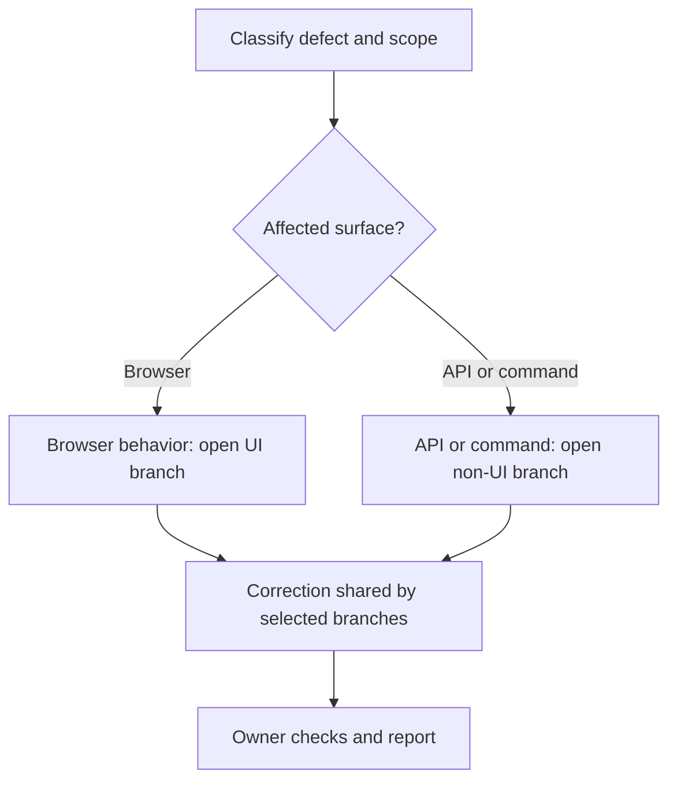

# Bug-Fix Branches

Optional [diagram guidance](../../execution/diagrams.md).

| Step | Detailed instructions                                  |
| ---- | ------------------------------------------------------ |
| 1    | [Classify defect and scope](README.md)                 |
| 2    | [Browser behavior: open UI branch](ui/flow.md)         |
| 3    | [API or command: open non-UI branch](non-ui/flow.md)   |
| 4    | [Correction shared by selected branches](implement.md) |
| 5    | [Owner checks and report](../../execution/verify.md)   |
