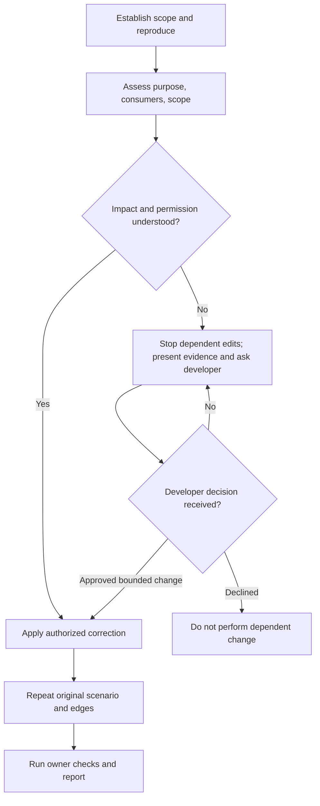

# UI Bug Fix

Optional [diagram guidance](../../../execution/diagrams.md).

| Step | Detailed instructions                                            |
| ---- | ---------------------------------------------------------------- |
| 1    | [Establish scope and reproduce](investigate.md)                  |
| 2    | [Assess purpose, consumers, scope](../../../execution/impact.md) |
| 3    | [Apply authorized correction](../implement.md)                   |
| 4    | [Repeat original scenario and edges](verify.md)                  |
| 5    | [Run owner checks and report](../../../execution/verify.md)      |
