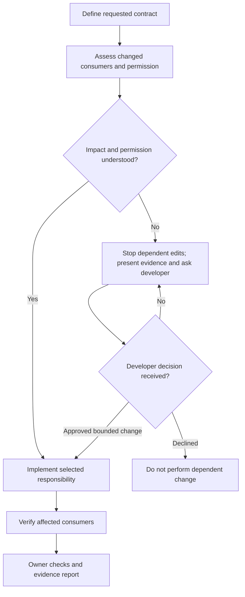

# Create Component

Optional [diagram guidance](../../../execution/diagrams.md).

| Step | Detailed instructions                                                   |
| ---- | ----------------------------------------------------------------------- |
| 1    | [Define requested contract](define.md)                                  |
| 2    | [Assess changed consumers and permission](../../../execution/impact.md) |
| 3    | [Implement selected responsibility](../implement.md)                    |
| 4    | [Verify affected consumers](../verify.md)                               |
| 5    | [Owner checks and evidence report](../../../execution/verify.md)        |
