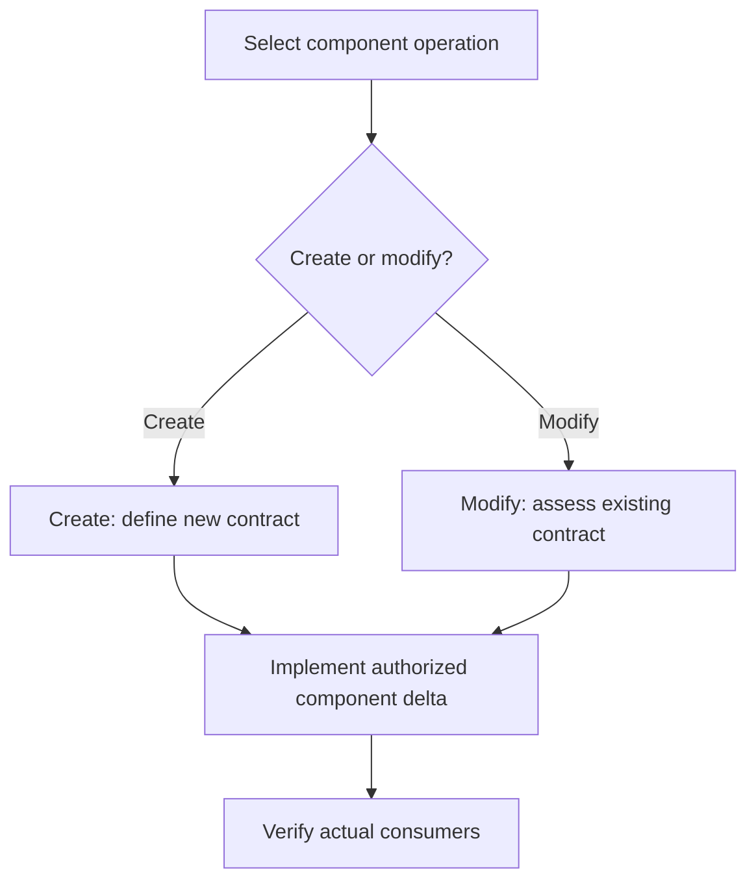

# Component Operations

Optional [diagram guidance](../../execution/diagrams.md).

| Step | Detailed instructions                                |
| ---- | ---------------------------------------------------- |
| 1    | [Select component operation](README.md)              |
| 2    | [Create: define new contract](create/README.md)      |
| 3    | [Modify: assess existing contract](modify/README.md) |
| 4    | [Implement authorized component delta](implement.md) |
| 5    | [Verify actual consumers](verify.md)                 |
