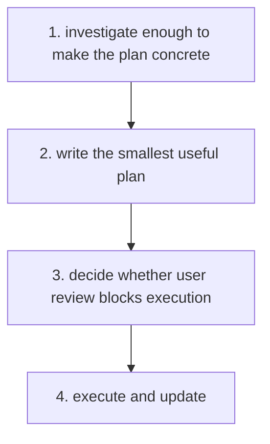

# Planning

Optional [diagram guidance](../../execution/diagrams.md).

| Step | Detailed instructions                                                                                       |
| ---- | ----------------------------------------------------------------------------------------------------------- |
| 1    | [1. investigate enough to make the plan concrete](README.md#1-investigate-enough-to-make-the-plan-concrete) |
| 2    | [2. write the smallest useful plan](README.md#2-write-the-smallest-useful-plan)                             |
| 3    | [3. decide whether user review blocks execution](README.md#3-decide-whether-user-review-blocks-execution)   |
| 4    | [4. execute and update](README.md#4-execute-and-update)                                                     |
