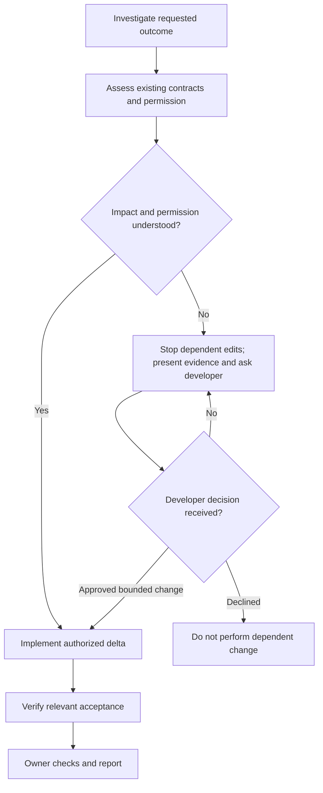

# Refactor

Optional [diagram guidance](../../execution/diagrams.md).

| Step | Detailed instructions                                                 |
| ---- | --------------------------------------------------------------------- |
| 1    | [Investigate requested outcome](../../execution/context.md)           |
| 2    | [Assess existing contracts and permission](../../execution/impact.md) |
| 3    | [Implement authorized delta](implement.md)                            |
| 4    | [Verify relevant acceptance](verify.md)                               |
| 5    | [Owner checks and report](../../execution/verify.md)                  |
