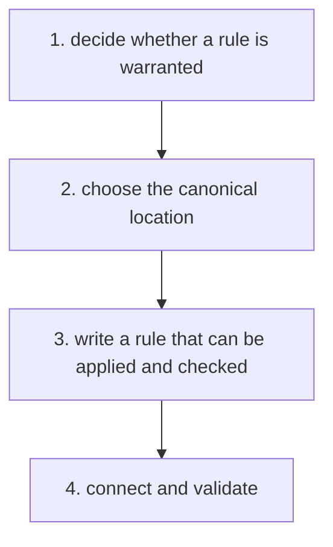

# Rule Maintenance

Optional [diagram guidance](../../execution/diagrams.md).

| Step | Detailed instructions                                           |
| ---- | --------------------------------------------------------------- |
| 1    | [1. decide whether a rule is warranted](when-to-add.md)         |
| 2    | [2. choose the canonical location](placement.md)                |
| 3    | [3. write a rule that can be applied and checked](authoring.md) |
| 4    | [4. connect and validate](verification.md)                      |
