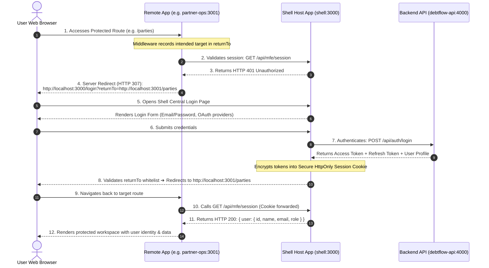

# Authentication & Single Sign-On (SSO) Flow

This document details the centralized authentication architecture, security model, and complete login/session lifecycle for the **Debt Flow Micro Frontend** workspace.

---

## Shared sign-out flow

Every standalone app (Shell on 3000, Partner Ops on 3001, and Payments on 3002)
opens a translated confirmation dialog from its account menu. Cancel and Escape
leave the session and URL unchanged. Confirmation calls `signOutFromPlatform`
from `@packages/platform-sdk`, using same-origin `/api/auth/csrf` and
`/api/auth/signout` endpoints through the existing remote API proxies. The helper
validates CSRF/HTTP responses before redirecting to Platform `/login?callbackUrl=...`,
where `callbackUrl` preserves the originating app's full URL (origin, path, query,
and fragment). Login validates that destination against the origin allowlist and
returns to it after authentication. Older `returnTo` links are also accepted. Failures
remain in the dialog with a retry action. Never navigate to `/api/auth/signout`
from an account menu. React hosts share `SignOutDialog` from `@packages/ui-react`;
the Angular standalone host uses a native modal dialog with the same behavior.
Embedded remotes continue to use the Shell's account controls.

## 1. Authentication Architecture Overview



---

## 2. Step-by-Step Flow Explanation

### Step 1: Initial Protected Route Access

- A user visits a remote application directly in standalone mode (e.g., `http://localhost:3001/parties` or `https://partner-ops.vercel.app/parties`).
- The remote's `middleware.ts` intercepts the request and sets the `x-debtflow-return-to` header with the current full URL.

### Step 2 & 3: Server-Side Session Verification

- The remote application layout (`apps/partner-ops/src/app/(workspace)/layout.tsx`) calls `getCoreIdentity()` on the server side before rendering.
- `getCoreIdentity()` queries the Shell Host's identity endpoint:
  ```http
  GET /api/mfe/session
  Host: localhost:3000
  Cookie: <forwarded_cookies>
  ```
- If no valid session cookie exists, the Shell returns `HTTP 401 Unauthorized`.

### Step 4 & 5: Centralized Redirection to Shell Host

- The remote application triggers a clean server-side redirect:
  ```http
  HTTP/1.1 307 Temporary Redirect
  Location: http://localhost:3000/login?returnTo=http://localhost:3001/parties
  ```
- The user's browser opens the centralized login page hosted by `@debtflow/shell`.

### Step 6 & 7: Authentication & Token Encryption

- The user inputs credentials (or chooses an OAuth provider such as Google).
- NextAuth.js on the Shell server verifies the credentials against `debtflow-api`:
  ```http
  POST /api/auth/login
  Content-Type: application/json

  {
    "email": "admin@debtflow.local",
    "password": "..."
  }
  ```
- Upon successful authentication, the Backend returns a short-lived **Access Token** and a long-lived **Refresh Token**.
- **Security Guarantee:** Tokens are encrypted into an **HttpOnly, SameSite=Lax, Secure Cookie** managed by NextAuth.js. No client-side JavaScript can ever access the raw tokens (immune to XSS).

### Step 8 & 9: Whitelisted Return Redirection

- Before redirecting, the Shell verifies that `returnTo` matches one of the origins in `AUTH_ALLOWED_RETURN_ORIGINS` (preventing Open Redirect vulnerabilities).
- The browser is redirected back to the original destination (`http://localhost:3001/parties`).

### Step 10, 11 & 12: Verified Identity Resolution

- The remote app checks session status again via `GET /api/mfe/session`.
- With the newly issued session cookie in place, the Shell returns the verified user identity:
  ```json
  {
    "user": {
      "id": "usr_123",
      "name": "Admin User",
      "email": "admin@debtflow.local",
      "role": "ADMIN"
    }
  }
  ```
- The remote app renders the workspace header, navigation permissions, and domain data.

---

### Login entry and return navigation

All credentials are entered at the Shell's `/login`. The login page verifies the
existing session before rendering the form. An authenticated user is immediately
redirected to the validated `returnTo` URL, or to `/` if no safe target was supplied.

- Shell protected pages preserve the requested path and query in `returnTo`.
- Partner Ops protected pages preserve their full standalone URL. Its `/login`
  alias forwards to central login with `/parties` on the Partner Ops origin as the
  destination.
- The standalone Payments sign-in link includes its current full URL, including
  query parameters and fragment. Its `/login` alias forwards to central login with
  `/` on the Payments origin as the destination. Embedded Payments does not redirect
  the host or create a separate login flow.
- Cross-origin navigation after login uses `location.replace`, so Back does not
  re-open the submitted login form.
- Return targets must use HTTP(S), must be on an explicitly allowed origin, must
  not include URL credentials, and must not point to `/login`, `/api`, or `/_next`.
  Invalid targets fall back to the Shell homepage.

The login aliases and redirects control navigation only; protected pages and API
endpoints continue to verify the session and permissions independently.

## 3. Silent Token Refresh Mechanism

To prevent users from being abruptly logged out during active sessions, `@debtflow/shell` implements an automated server-side token refresh:

```text
┌─────────────────────────────────────────────────────────────────────────┐
│                        Token Refresh Buffer Flow                        │
│                                                                         │
│  1. JWT Callback checks expiration timestamp.                           │
│  2. If (ExpiresAt - Date.now() < 60,000ms):                             │
│     Shell calls Backend: POST /api/auth/refresh { refreshToken }        │
│  3. New Access Token is encrypted into session cookie transparently.    │
│  4. User experiences ZERO interruption or re-login prompts.             │
└─────────────────────────────────────────────────────────────────────────┘
```

---

## 4. Multi-Domain & Cross-Origin Configuration

### Environment Variables Matrix

| Variable                      | App                | Purpose                                                         |
| :---------------------------- | :----------------- | :-------------------------------------------------------------- |
| `AUTH_SECRET`                 | `apps/shell`       | 32-byte secret used to sign and encrypt session cookies         |
| `AUTH_URL`                    | `apps/shell`       | Base URL of the Shell authentication server                     |
| `AUTH_ALLOWED_RETURN_ORIGINS` | `apps/shell`       | Whitelisted origins allowed to receive post-login redirects     |
| `PLATFORM_ORIGIN`             | `apps/partner-ops` | Target Shell origin used for login redirects and session checks |

### Production Sub-Domain Sharing (`*.debtflow.vn`)

In production environments sharing a common root domain:

- Configure cookie domain on Shell: `Domain=.debtflow.vn`
- Session cookies are automatically dispatched to `app.debtflow.vn`, `partner.debtflow.vn`, and `payments.debtflow.vn`.

## Login source map

| Responsibility                                        | Canonical source                                                                          |
| ----------------------------------------------------- | ----------------------------------------------------------------------------------------- |
| Login route and trusted destination                   | `apps/shell/src/app/(auth)/login/page.tsx`, `apps/shell/src/lib/auth/login-navigation.ts` |
| Form rendering                                        | `apps/shell/src/features/auth/login/login-form.tsx`                                       |
| Form state, submission and post-login navigation      | `apps/shell/src/features/auth/login/use-login-form.ts`                                    |
| Validation, default/demo values and props             | `apps/shell/src/features/auth/login/schema.ts`, `login.types.ts`                          |
| Browser NextAuth adapter                              | `apps/shell/src/lib/auth/client.ts` — the only browser `signIn('credentials', ...)` call  |
| Backend login/refresh requests and response contracts | `apps/shell/src/services/auth/`                                                           |
| NextAuth provider/callback composition                | `apps/shell/src/lib/auth/session.ts`                                                      |
| User mapping, token expiration and refresh policy     | `apps/shell/src/lib/auth/tokens.ts`, `auth.types.ts`                                      |

The form calls its feature hook; the hook calls the NextAuth adapter with an object of credentials. NextAuth handles CSRF and session cookies, then its server provider calls the auth service. Neither the form nor its hook calls the backend login endpoint directly. The service owns JSON serialization; session/token modules own authentication policy. Local and approved cross-origin return destinations retain query parameters and fragments. Run `npm run test:auth` for adapter, service, token and redirect regression checks.
